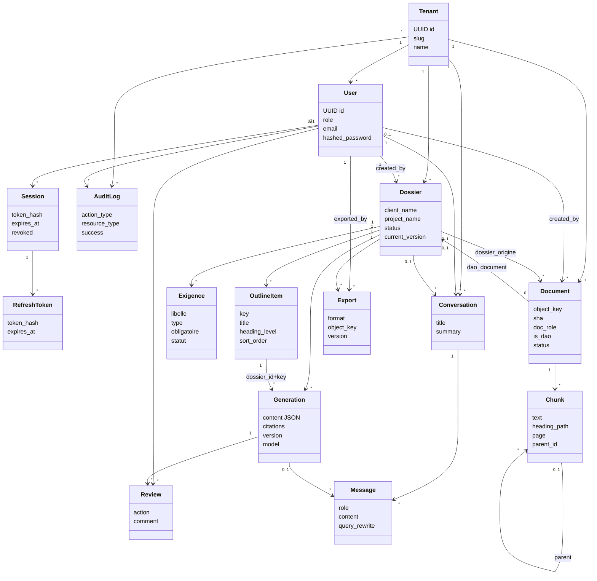

# Architecture — Plateforme de capitalisation et génération de dossiers d’appels d’offres (BTP)


---

## 1. Problème métier

Une entreprise BTP accumule des dizaines ou centaines de dossiers (DAO, CCTP, CCAP, mémoires techniques, DPGF, références chantier). Aujourd’hui cette mémoire est **peu exploitable** : recherche manuelle, copier-coller, perte de traçabilité.

Le système doit :

1. **Capitaliser** le patrimoine (anciens dossiers) et le DAO **courant**.
2. **Retrouver** des passages, références et capacités avec sources.
3. **Structurer** un nouveau dossier (exigences, plan, sections).
4. **Faire valider** chaque section par un humain (HITL).
5. **Exporter** un DOCX (puis PDF) versionné.

Ce n’est **pas** : « un LLM qui écrit 50 pages d’un coup ».  
Ce n’est **pas** : un essaim d’agents autonomes (CrewAI, etc.) en V1.

---

## 2. Principe d’architecture

**Workflow déterministe + intelligence locale.**  
Les étapes métier sont connues à l’avance. Le LLM rédige et classifie ; **le code** cherche, filtre, valide et interrompt pour l’humain.

```text
     PROCESSUS MÉTIER (connu)              INTELLIGENCE (locale)
     ========================              =====================
     upload → parse → index                embeddings, rerank
     extraire exigences                    LLM JSON contraint
     rechercher patrimoine                 RAG hybride
     rédiger UNE section                   LLM + citations
     revue humaine                         approve / edit / regen
     assembler export                      python-docx (pas le LLM)
```

Un **agent** n’est utile que si le chemin n’est pas prédictible (recherche multi-sauts, etc.). En V1 : **pas d’agents**. Un nœud de l’orchestrateur peut plus tard encapsuler une recherche agentique **sans** changer le reste du processus.

---

## 3. Architecture métier (vue généraliste)

Aucun nom de produit ici : uniquement des **rôles**. La correspondance technique est en §4 et §6.

```text
                         RÉDACTEUR AO
                    (chat, revue, export)
                              │
                              ▼
                    COUCHE APPLICATIVE
                 (API, sessions, droits)
                              │
              ┌───────────────┴───────────────┐
              │ HORLOGE A                     │ HORLOGE B
              │ capitalisation                │ exploitation
              ▼                               ▼
     FILE DE TRAVAUX                    ORCHESTRATEUR
     (jobs longs)                       DE PROCESSUS
              │                         (étapes + revue humaine)
              ▼                               │
     COMPRÉHENSION                      ┌─────┴──────┬────────────┐
     DE DOCUMENT                        ▼            ▼            ▼
     (PDF numérique / scan)      RECHERCHE      BASE          BASE
              │                  DE PASSAGES    RELATIONNELLE GRAPHE
              │                  (similarité    (faits,       (LECTURE
              ▼                   de texte)      versions,      des liens)
     ┌────────┼────────┬────────┐               citations)
     ▼        ▼        ▼        ▼
  ENTREPÔT  BASE    INDEX    BASE GRAPHE
  FICHIERS  RELAT.  VECTORIEL (ÉCRITURE
            extraits          des liens,
            + métadonnées     phase 1.5)
                                      │
                                      ▼
                                     LLM
                                      │
                                      ▼
                              section JSON + sources
                                      │
                                      ▼
                              validation humaine
                                      │
                                      ▼
                              ENTREPÔT (export dossier)
```

| Rôle métier | Question à laquelle il répond |
|-------------|-------------------------------|
| Entrepôt de fichiers | Où sont les PDF / DOCX originaux et l’export ? |
| Base **relationnelle** | Quels sont les faits, textes d’extraits, versions, audits ? (tables, SQL) |
| Index de recherche de passages | Quels extraits **ressemblent** à la question ? |
| Base **graphe** | Quels **liens** entre projets, clients, certifications, personnes ? |
| File de travaux | Comment parser / extraire **sans** bloquer l’utilisateur ? |
| Orchestrateur de processus | Dans quel **ordre** analyser, rédiger, interrompre pour l’humain ? |
| LLM | Rédaction et extraction JSON **bornées**, pas la recherche elle-même |

La base graphe **n’est pas** la base relationnelle : la relationnelle garde le **texte citable** ; le graphe garde les **relations**. L’écriture graphe a lieu sur l’horloge A (après compréhension du document) ; la lecture sur l’horloge B.

---

## 4. Vue d’ensemble (implémentation)

```text
                         ┌─────────────────────────────────────┐
                         │     UTILISATEUR (rédacteur AO)      │
                         │   chat · revue de sections · export │
                         └──────────────────┬──────────────────┘
                                            │  HTTP (JWT)
                                            ▼
                         ┌─────────────────────────────────────┐
                         │              FastAPI                │
                         │   porte : upload, messages, revue   │
                         └──────────────────┬──────────────────┘
                                            │
                    ┌───────────────────────┼───────────────────────┐
                    │ HORLOGE A             │                       │ HORLOGE B
                    │ (lente, async)        │                       │ (interactive)
                    ▼                       │                       ▼
         ┌──────────────────┐               │            ┌─────────────────────┐
         │  Redis + ARQ     │               │            │  Orchestrateur      │
         │  ingest_document │               │            │  (LangGraph) + HITL │
         │  extract_graph   │               │            └──────────┬──────────┘
         │  similarités     │               │                       │
         └────────┬─────────┘               │         ┌─────────────┼─────────────┐
                  │                         │         ▼             ▼             ▼
                  ▼                         │    recherche     Postgres      Neo4j
         Docling / PaddleOCR                │    hybride       (métier)     (LECTURE)
                  │                         │    LlamaIndex                     │
                  ▼                         │    + Qdrant                       │
         ┌────────┴────────┬────────┐       │         └─────────────┴─────────────┘
         ▼        ▼        ▼        ▼       │                       │
      MinIO   Postgres  Qdrant   Neo4j      │                       ▼
     fichiers  chunks   vecteurs ÉCRITURE   │                      LLM
                       extraits  graphe 1.5 │                       │
                                            │                       ▼
                                            │              JSON section + citations
                                            │                       │
                                            │                       ▼
                                            │              interrupt → humain
                                            │                       │
                                            └───────────────────────┘
                                                                ▼
                                                         MinIO (export DOCX)
```

**Analogie :** API = standardiste ; file de jobs = atelier ; orchestrateur = chef de chantier ; recherche de passages = ouvriers documentaires ; entrepôt = archives ; base relationnelle = registre ; index vectoriel = catalogue sémantique ; base graphe = organigramme des liens métier.

L’utilisateur **ne parle jamais** à LlamaIndex, LangGraph ou MinIO.

---

## 5. Deux horloges (point critique)

Les embeddings et le parse **ne se font pas** au moment de la question.

```text
HORLOGE A — INGESTION
=====================
Upload PDF/DOCX/XLSX
  → FastAPI : MinIO + ligne documents (pending) + job Redis
  → HTTP 200 immédiat  (pas de parse dans la requête)

Worker ARQ (processus séparé)
  → GET MinIO
  → PDF digital ? Docling  :  scan ? PaddleOCR PP-Structure
  → XLSX ? openpyxl → lignes SQL (pas de prose vectorisée)
  → chunking structure (articles, parent/enfant)
  → embed → Qdrant + texte des chunks dans Postgres
  → documents.status = ready          (le RAG peut déjà servir)
  → job extract_graph (phase 1.5) : chunks parents → MERGE Neo4j
  → documents.graph_extracted = true
  → (nuit) job similarités entre PROJET

Tant que status ≠ ready : pas de génération de section.
graph_extracted = false n’empêche pas le RAG, seulement les questions « lien entre entités ».

Le graphe se **écrit** ici, après Docling/Paddle, **pas** au moment du chat.
Le PDF n’est plus relus : on part du Markdown / des chunks déjà en Postgres
(titres, pages, tenant_id). C’est ça qui évite de « perdre le contexte ».


HORLOGE B — QUESTION / DOSSIER
==============================
On NE relit PAS le PDF. On NE ré-embedde PAS. On NE ré-extrait PAS le graphe.
  → Router LangGraph (règles + petit classifieur)
  → retrieve hybride (Qdrant)  et/ou  lecture Neo4j (MATCH déjà indexé)
  → construction de contexte numéroté [1]…[k]
  → UN appel LLM rédacteur (JSON)
  → validation déterministe (citations existantes)
  → interrupt humain si section d’offre
```

---

## 6. Couches techniques (ce n’est pas la même chose)

| Couche | Rôle | Choix retenu |
|--------|------|----------------|
| HTTP | Porte d’entrée | **FastAPI** |
| Jobs longs | Parse / embed hors requête | **ARQ + Redis** |
| Fichiers bruts et exports | Objets S3 | **MinIO** |
| RAG (chunk, retrieve) | Bibliothèque Python | **LlamaIndex** |
| Orchestration métier | Ordre, état, HITL | **LangGraph** |
| Contrats de données | JSON typé | **Pydantic** |
| Recherche vectorielle | Dense + sparse, filtres | **Qdrant** |
| Vérité métier, citations, chat | Relationnel | **PostgreSQL** (+ pgvector installé, **non utilisé** en V1 pour la recherche) |
| Graphe de relations | Phase **1.5** | **Neo4j** (déjà lancé, pas encore alimenté) |
| LLM / embeddings | Inférence locale ou API | **LLM** + modèle d’embeddings (configurables) |
| Embeddings / rerank **cibles** | Qualité AO FR | **BGE-M3** + **BGE-reranker-v2-m3** |
| Parse digital / scans | Document understanding | **Docling** / **PaddleOCR** (extras, pas l’image Docker minimale) |

**Écart V1 actuelle vs cible RAG :** le socle tourne déjà (API, Postgres, Qdrant, MinIO, worker). Le parse Docling/Paddle et BGE-M3 viennent **après** le `/health` et le schéma SQL. Le LLM est interchangeable via la configuration. GPU optionnel (`USE_GPU=false` par défaut).

LangChain n’est **pas** le cœur : éventuellement des tools.

---

## 7. Où est stocké quoi (sources de vérité)

```text
                    DOCUMENT HISTORIQUE / DAO
                              │
                              ▼
                         INGESTION
                              │
            ┌─────────────────┼─────────────────┬─────────────┐
            ▼                 ▼                 ▼             ▼
         MinIO            Postgres            Qdrant        Neo4j
      PDF/DOCX/XLSX     chunks.text          vecteurs     nœuds + arêtes
      exports DOCX      exigences            chunk_id     (écrit en A,
                        generations                       lu en B)
                        reviews, messages
```

| Donnée | Stockage | Pourquoi |
|--------|----------|----------|
| Originaux PDF/DOCX/XLSX | MinIO | Gros binaires |
| Texte des chunks + pages | **Postgres `chunks`** | Citation `[3]` = `SELECT`, audit |
| Vecteurs | Qdrant (`chunk_id`) | k-NN hybride |
| Exigences, plan, versions de sections | Postgres | Métier, versions |
| Décisions humaines | Postgres `reviews` | HITL traçable |
| Chat | `conversations` / `messages` | Fil + rewrite de « ça » |
| Export Word | MinIO `ao-exports` | Livrable |
| Job en cours | Redis | Éphémère |
| Entités / relations | Neo4j | Phase 1.5 |

Le texte généré par le LLM va dans `generations.content`, **pas** dans Qdrant.

---

## 8. Pipeline d’ingestion (document understanding)

Un AO n’est pas « du texte OCR ». Il y a titres, articles, tableaux, tampons, annexes.

```text
                    PDF / DOCX / XLSX / SCAN
                              │
                    densité de texte du PDF
                              │
              ┌───────────────┴───────────────┐
              ▼                               ▼
        PDF numérique                      Scan / image
           Docling                    PaddleOCR PP-Structure
              │                               │
              └───────────────┬───────────────┘
                              ▼
                    Markdown + tables + titres
                              │
                    découpe STRUCTURE
                    (Article 12, ##, une table = 1 chunk)
                              │
                    parent (section) / child (alinéa)
                              │
                    préfixe embeddé :
                    [Pièce: CCAP] [Article 8] [p.14]
                              │
                    Qdrant + Postgres
```

Seuil OCR bas → `needs_review`, pas d’indexation silencieuse.

---

## 9. RAG hybride (moteur de recherche V1)

Les DAO sont plein de termes **exacts** (ISO 9001, lot 03, article 5.2, 50 t). Le vectoriel seul est insuffisant.

```text
                         REQUÊTE
                            │
                 (rewrite si « ça », « le dernier »)
                            │
              ┌─────────────┼─────────────┐
              ▼             ▼             ▼
           dense         sparse        SQL
         (sémantique)   (BM25 /      (montant,
                         lexical)     certif)
              │             │             │
              └─────────────┼─────────────┘
                            ▼
                    fusion RRF + filtres
                    (tenant, doc_role, année…)
                            ▼
                         rerank
                      Top-50 → Top-8
                            ▼
                    remplacer child → parent
                            ▼
                    contexte [1]…[k]  →  LLM
```

Filtres importants : pour rédiger une offre, on cherche dans le **patrimoine** / archives, **pas** dans le DAO courant d’un autre dossier (pollution).

**GraphRAG** n’est pas un remplacement : second index pour « qui satisfait quelle exigence », après que l’hybride marche.

---

## 10. Workflow de constitution du dossier

Graphe **borné**, avec interruption humaine. On ne régénère pas 60 pages : une **section** à la fois, versions conservées.

```text
    START
      │
      ▼
 ┌─────────────┐
 │    route    │  règles + petit LLM JSON
 └──────┬──────┘  (smalltalk | rag | graphe | run_section)
        │
        ├── smalltalk ──────────────► réponse courte
        │
        ├── rag ─► rewrite? ─► retrieve ─► context ─► generate
        │
        └── run_section
                 │
                 ▼
          retrieve patrimoine
                 │
                 ▼
          build_context
                 │
                 ▼
          generate (JSON SectionGeneree)
                 │
                 ▼
          validate (citations existent ?)
                 │
          ┌──────┴──────┐
        FAIL           OK
          │             │
          ▼             ▼
       corriger     INTERRUPT  ◄── humain
                        │
              ┌─────────┼─────────┐
              ▼         ▼         ▼
           approve    edit      regen
              │         │         │
              ▼         ▼         └──► generate (consigne)
         section OK   texte humain
              │
              ▼
         (autres sections…)
              │
              ▼
           export DOCX
```

Actions `reviews` : `approve` | `edit` | `regen` (+ commentaire).

Le LLM **ne va pas** chercher dans MinIO : il ne voit que le contexte collé par le nœud `retrieve`.

---

## 11. Parcours chronologique (exemple)

```text
1. Upload DAO_Gare_Nantes.pdf
      documents (dao_courant, pending) → MinIO → job ARQ → chunks + Qdrant → ready

2. Conversation « répondre à l’AO gare de Nantes »
      conversations + messages
      création dossiers (client, projet, statut draft)

3. Extraction d’exigences (LLM JSON)
      exigences (ISO 9001, 5 ans ferroviaire, CA, délai…)

4. Plan
      outline_items (présentation, moyens, références, QSE…)

5. « Génère la section Références »
      retrieve (patrimoine) → generations v1 + citations

6. Humain : regen « insister sur les grues 50 t »
      reviews.regen → generations v2 → approve

7. Export
      assemble sections approved → DOCX → MinIO → dossiers.exported
```

---

## 12. Schéma de base de données (PostgreSQL)

Isolation : chaque ligne métier porte `tenant_id` (**UUID**). Le slug (`vinci`) sert aux URL et préfixes MinIO, pas comme clé étrangère.

Rôles utilisateurs : `admin`, `manager`, `redacteur`, `consultant`.  
Rôles document : `patrimoine` | `dao_courant` | `dao_archive`.

Qdrant n’est pas dans ce schéma : un point vecteur a `id = chunks.id`.

### 11.1 Diagramme de classes (relations)

Cardinalités : `1` / `0..1` / `*` (plusieurs).

```text
┌──────────────┐  1         *  ┌──────────────┐  1         *  ┌──────────────┐
│    Tenant    │──────────────►│     User     │──────────────►│   Session    │
│ id, slug     │               │ role, email  │               │ token_hash   │
└──────┬───────┘               └──────┬───────┘               └──────┬───────┘
       │                              │                              │ 1
       │                              │                              ▼ *
       │                              │                       ┌──────────────┐
       │                              │                       │ RefreshToken │
       │                              │                       └──────────────┘
       │                              │
       │         1                    │ 0..1
       │         │                    │
       │         ▼ *                  ▼ *
       │  ┌──────────────┐     ┌──────────────┐
       │  │  AuditLog    │◄────│              │
       │  └──────────────┘     │              │
       │                       │              │
       │  1                    │ created_by   │
       ├───────────────────────┤              │
       │                       │              │
       ▼ *                     ▼ *            │
┌──────────────┐  1      *  ┌──────────────┐  │
│   Document   │───────────►│    Chunk     │  │
│ doc_role     │            │ parent_id ───┼──┤  (auto-réf. parent / child)
│ object_key   │            │ text, page   │  │
└──────┬───────┘            └──────────────┘  │
       │ 0..1                                 │
       │ dao_document_id                      │
       ▼ 1                                    │
┌──────────────┐  created_by *                │
│   Dossier    │◄─────────────────────────────┘
│ client, projet│
└──────┬───────┘
       │ 0..1 dossier_origine_id
       │ (document issu d’un ancien dossier)
       │
       │ 1
       ├──────────────────┬──────────────────┬──────────────────┐
       ▼ *                ▼ *                ▼ *                ▼ *
┌──────────────┐  ┌──────────────┐  ┌──────────────┐  ┌──────────────┐
│  Exigence    │  │ OutlineItem  │  │ Conversation │  │    Export    │
│ type, statut │  │ key, title   │  │ title        │  │ docx | pdf   │
└──────────────┘  └──────┬───────┘  └──────┬───────┘  └──────────────┘
                         │ 1               │ 1              ▲
                         ▼ *               ▼ *              │ exported_by
                  ┌──────────────┐  ┌──────────────┐        │
                  │  Generation  │  │   Message    │        │
                  │ content JSON │  │ role, text   │        │
                  │ citations[]  │  └──────┬───────┘        │
                  │ version      │         │ 0..1           │
                  └──────┬───────┘         │ generation_id  │
                         │ 1               │                │
                         ▼ *               │                │
                  ┌──────────────┐         │                │
                  │    Review    │         │                │
                  │ approve/edit │         │                │
                  │ regen/skip   │         │                │
                  └──────┬───────┘         │                │
                         │ user_id         │                │
                         └─────────────────┴────────────────┘
                                      User
```

Lien **Document ↔ Dossier** (circulaire, volontaire) :

- `dossiers.dao_document_id` → le DAO **courant** de ce dossier.
- `documents.dossier_origine_id` → un fichier de **patrimoine** issu d’un dossier déjà traité.

`generations` est lié à `outline_items` par la paire `(dossier_id, section_key)` = `(dossier_id, key)`.

Vue UML (mêmes relations) :



### 11.2 Tables — auth

| Table | Rôle | Attributs principaux | Relations |
|-------|------|----------------------|-----------|
| **tenants** | Entreprise cliente isolée | `id` UUID, `slug`, `name`, `email`, `config` JSONB, `status` | Racine de l’isolation |
| **users** | Compte humain | `username`, `email`, `hashed_password`, `role`, `permissions`, `status`, lock brute-force | `*` → 1 tenant |
| **sessions** | Session d’accès (hash JWT) | `token_hash`, `expires_at`, `revoked`, IP / UA | `*` → 1 user |
| **refresh_tokens** | Renouvellement | `token_hash`, `expires_at`, `revoked` | `*` → 1 session |
| **audit_logs** | Trace des actions | `action_type`, `resource_*`, `details`, `success` | `*` → 1 tenant ; 0..1 user |

### 11.3 Tables — métier

| Table | Rôle | Attributs principaux | Relations |
|-------|------|----------------------|-----------|
| **documents** | Fichier (MinIO) + métadonnées | `object_key`, `sha`, `doc_role`, `doc_type`, `is_dao`, `status`, OCR | `*` → 1 tenant ; 0..1 user (`created_by`) ; 0..1 dossier origine |
| **chunks** | Texte indexable / citable | `text`, `heading_path`, `page`, `parent_id` | `*` → 1 document ; 0..1 chunk parent |
| **dossiers** | Une réponse AO en cours | `client_name`, `project_name`, `dao_reference`, `deadline`, `status`, `current_version` | `*` → 1 tenant ; 0..1 document DAO ; 1 user créateur |
| **exigences** | Critère extrait du DAO | `libelle`, `type`, `obligatoire`, `statut`, `preuves_chunks` JSON | `*` → 1 dossier |
| **outline_items** | Plan du mémoire | `key`, `title`, `heading_level`, `sort_order`, `status` | `*` → 1 dossier ; `key` unique par dossier |
| **generations** | Une version de section | `content` JSONB, `citations`, `context_snapshot`, `model`, `version` | `*` → 1 dossier + 1 outline (`section_key`) |
| **reviews** | Décision humaine HITL | `action`, `comment`, `modified_text`, `regen_instruction` | `*` → 1 generation ; 1 user |
| **conversations** | Fil de discussion | `title`, `summary` | `*` → 1 tenant, 1 user ; 0..1 dossier |
| **messages** | Tour de parole | `role`, `content`, `query_rewrite` | `*` → 1 conversation ; 0..1 generation |
| **exports** | Livrable généré | `format` docx/pdf, `object_key` MinIO, `version` | `*` → 1 dossier ; 1 user (`exported_by`) |

### 11.4 Statuts utiles

```text
documents.status     pending → processing → ready | failed | needs_review
dossiers.status      draft → analyzing → generating → review
                     → ready_export → exported → archived
exigences.statut     a_couvrir → en_cours → couverte | non_couverte | a_revoir
outline_items.status todo → generated → approved | rejected
reviews.action       approve | edit | regen | skip
```

---

## 13. Déploiement (deux modes)

```text
MODE DEV (hybride)                    MODE IMAGE (profil Compose « app »)
==================                    ==================================
LLM sur l’hôte                        LLM sur l’hôte (réseau Docker → hôte)
uv + .venv : FastAPI --reload         conteneurs api + worker
                                      │
        ┌─────────────────────────────┴─────────────────────────────┐
        ▼         ▼         ▼         ▼         ▼
    Postgres   Qdrant    Neo4j     Redis     MinIO
    (Docker)  (Docker)  (Docker)  (Docker)  (Docker)
```

GPU optionnel (`USE_GPU` + overlay Compose). Pas obligatoire en V1.

---

## 14. Roadmap

| Phase | Contenu |
|-------|---------|
| **Socle (fait)** | Compose, schéma SQL, FastAPI `/health`, ARQ, MinIO, Qdrant, Neo4j vide |
| **V1 métier** | Auth JWT, ingest Docling, RAG hybride, LangGraph + HITL, export DOCX |
| **V1.5** | BGE-M3 + reranker, graphe Neo4j (exigence ↔ projet / certif) |
| **Ensuite** | retrieval agentique **localisé**, évaluation (golden set, groundedness) |

---

## 15. Glossaire court

| Sigle | Sens |
|-------|------|
| **AO / DAO** | Appel d’offres / dossier d’appel d’offres (pièces du maître d’ouvrage) |
| **CCTP / CCAP** | Cahier des clauses techniques / administratives particulières |
| **HITL** | Human in the loop : validation humaine obligatoire avant suite |
| **RAG** | Retrieval-Augmented Generation : chercher puis générer avec sources |
| **RRF** | Fusion de classements (dense + lexical) |
| **Chunk** | Unité de texte indexée (souvent un article / alinéa) |
| **Tenant** | Entreprise cliente isolée (Vinci ≠ Bouygues) |

---

## 16. Phrase de conclusion (pour l’encadreur)

Le projet construit une **mémoire d’entreprise interrogeable** et un **atelier de rédaction contrôlé** : ingestion asynchrone, recherche hybride citée, workflow LangGraph section par section, revue humaine, export Word. L’IA est un **rédacteur outillé**, pas un décideur autonome. Les agents et le graphe s’ajoutent **là où le processus déterministe montre ses limites**, pas par défaut.

Sources internes : `Fichier/retenu.md`, `architecture_proposition.md`, `implementation_proposition.md`, `pipeline_technique_detaille.md`, `champsdeBase_et_contraites_workflow.md`.
