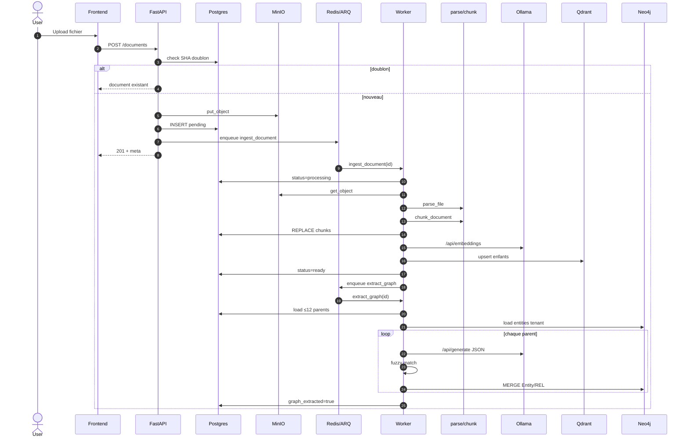
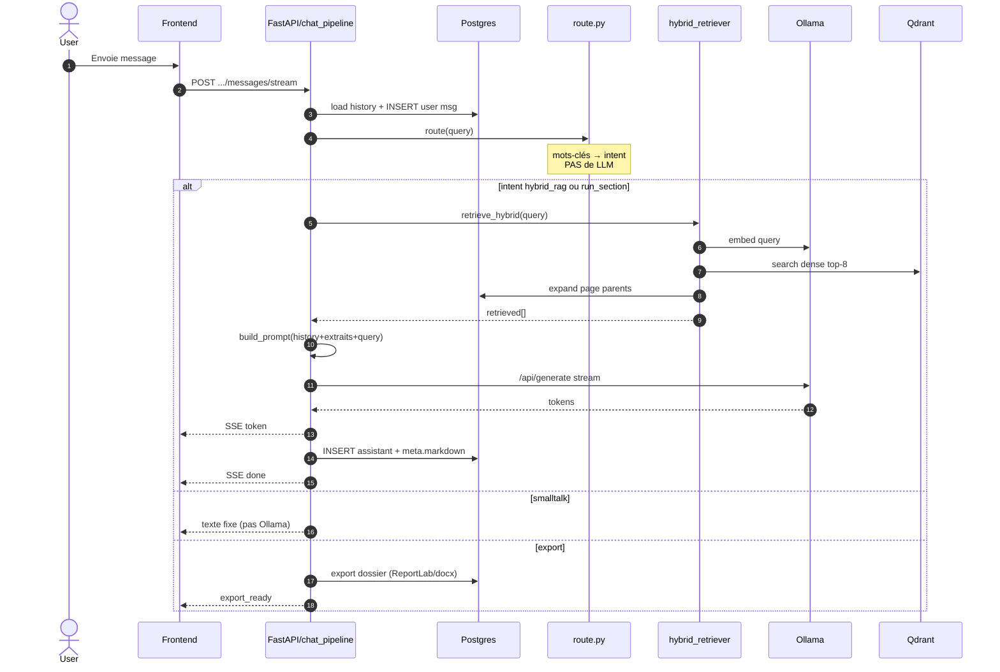
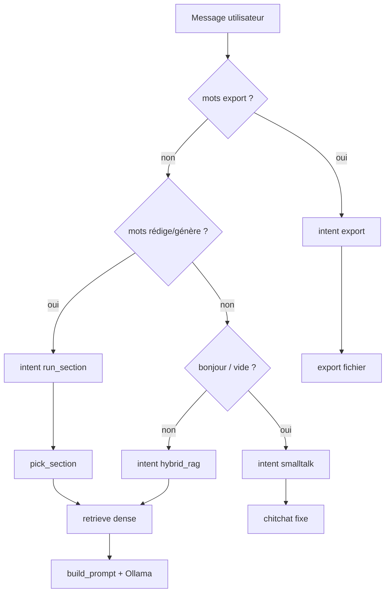

# Diagrammes de séquence & workflow ordonné — BTP RAG

Document généré pour dessiner des diagrammes de séquence (PlantUML / Mermaid / draw.io).  
**Ne remplace pas** `comprehension personnele du projets .md` (notes perso).  
État du code : août 2026 — ce qui est **réellement branché**, pas la cible théorique.

---

## 0. Vue d’ensemble : deux horloges

```text
┌─────────────────────────────────────────────────────────────────────────┐
│                         NAVIGATEUR (React / Vite)                        │
└───────────────────────────────┬─────────────────────────────────────────┘
                                │ HTTP / SSE
                                ▼
┌─────────────────────────────────────────────────────────────────────────┐
│                    FastAPI  (backend_ao/app)                              │
│  API sync courte : auth, upload, messages, statut documents              │
└───────────────┬─────────────────────────────────────┬───────────────────┘
                │                                     │
     HORLOGE A (async)                    HORLOGE B (sync / stream)
                │                                     │
                ▼                                     ▼
     Redis + worker ARQ                      LangGraph (ou nœuds manuels)
     ingest_document                         route → retrieve → generate
     extract_graph                           (pas d’ARQ)
                │                                     │
                ▼                                     ▼
     MinIO → parse → chunk                   Postgres history
     Postgres chunks                         Qdrant dense
     Ollama embed → Qdrant                   Ollama LLM
     Ollama LLM → Neo4j                      (Neo4j NON lu)
```

| Horloge | Déclencheur | File | But |
|---------|-------------|------|-----|
| **A — Ingestion** | Upload document | Redis / ARQ | Indexer le fichier (texte + vecteurs + graphe) |
| **B — Chat** | Message utilisateur | Aucune (requête HTTP) | Répondre / rédiger / exporter |

---

## 1. Qui est responsable de quoi (outils)

| Technologie | Rôle dans le projet | Horloge |
|-------------|---------------------|---------|
| **React + Vite** | UI, SSE client | B (affichage) |
| **FastAPI** | HTTP, auth JWT, orchestration courte | A + B |
| **PostgreSQL** | Vérité : users, documents, chunks, messages, dossiers | A + B |
| **MinIO** | Fichiers bruts (PDF/DOCX…) | A |
| **Redis + ARQ** | File de jobs longs (`ingest_document`, `extract_graph`) | A |
| **pypdf** | Extraction texte PDF + détection densité | A |
| **Docling** | Document understanding → markdown (si installé / OK) | A |
| **PaddleOCR + PyMuPDF** | OCR scans (PDF → images → texte) | A |
| **python-docx / openpyxl** | DOCX / XLSX | A |
| **Ollama `/api/embeddings`** | Vecteurs (`nomic-embed-text`) | A (écriture) + B (query) |
| **Qdrant** | Recherche dense cosine | A (upsert) + B (search) |
| **Ollama `/api/generate`** | LLM (`llama3`…) | A (extraction graphe) + B (réponse) |
| **Neo4j** | Entités / relations (écriture seule en V1) | A |
| **rapidfuzz + embed fuzzy** | Rapprochement noms d’entités | A (graphe) |
| **LangGraph** | Machine d’états chat (chemin sync) | B |
| **LlamaIndex** | **Présent en dépendance / stub** — **pas** sur le chemin runtime | — |
| **ReportLab** | Export PDF (pas WeasyPrint en V1) | B |

---

## 2. HORLOGE A — Upload → Neo4j (séquence complète)

### 2.1 Séquence ASCII « qui appelle qui »

```text
User / Frontend
    │  POST /documents  (ou POST /conversations/{id}/documents)
    ▼
FastAPI  app/api/documents.py  (ou conversations.py)
    │  auth user + tenant
    ▼
store_document()  app/services/document_upload.py
    │
    ├─(1)─ SHA-256 du fichier
    │       │
    │       ├─ SI même sha déjà en Postgres pour ce tenant
    │       │     → retourne document existant, duplicate=true
    │       │     → PAS de nouvel enqueue
    │       │
    │       └─ SINON continue
    │
    ├─(2)─ MinIO.put_object  (bucket raw, key = tenant/uuid/filename)
    │
    ├─(3)─ Postgres INSERT Document  status="pending"
    │
    └─(4)─ enqueue_ingest(document_id)
              app/services/queue.py
              │
              └─ Redis : job ARQ "ingest_document"

                    ~~~ asynchrone, worker séparé ~~~

Worker ARQ  app/worker_settings.py
    │  consomme ingest_document
    ▼
ingest_document()  app/workers/ingest.py
    │
    ├─ Postgres : status → "processing"
    ├─ MinIO.get_object → fichier temporaire
    ├─ parse_file()     app/ingest/parse.py
    ├─ chunk_document() app/ingest/chunk.py
    ├─ Postgres : REPLACE chunks (parents + enfants)
    ├─ embed_texts()    app/ingest/index_qdrant.py  → Ollama embeddings
    │     (surtout les ENFANTS ; si aucun enfant → parents)
    ├─ Qdrant upsert
    ├─ Postgres : status → "ready"  (+ ocr_used, page_count…)
    └─ enqueue_job("extract_graph", document_id)

Worker ARQ
    │  consomme extract_graph
    ▼
extract_graph()  app/graph/extract.py
    │
    ├─ SI status ≠ ready OU graph_extracted déjà true → stop
    ├─ Charge ≤ 12 chunks PARENTS (Postgres)
    ├─ Charge index entités Neo4j du tenant (fuzzy)
    ├─ POUR chaque parent :
    │     Ollama /api/generate (JSON entities + relations)
    │     fuzzy match (exact → Lev → Jaccard → embed)
    │     Neo4j MERGE Entity + REL
    └─ Postgres : graph_extracted = true
```

### 2.2 Conditions / décisions Horloge A

| Étape | Condition | Conséquence |
|-------|-----------|-------------|
| Upload | SHA déjà connu (tenant) | Pas de re-ingest |
| ARQ fail à l’enqueue | Redis KO | `status=failed`, erreur stockée |
| Parse | Extension / MIME | Route xlsx / docx / txt / pdf |
| PDF densité | `chars/page ≥ 40` | Branche **numérique** |
| PDF densité | `chars/page < 40` | Branche **scan** |
| Numérique | Docling OK | Parser = `docling` |
| Numérique | Docling KO | Parser = `pypdf` |
| Scan | `USE_GPU=true` | Paddle GPU puis CPU si cudnn/cuda |
| Scan | Paddle OK | Parser = `paddleocr-gpu` ou `-cpu` |
| Scan | Paddle KO | Essai Docling |
| Scan | Tout KO + un peu de texte | `pypdf-sparse` |
| Scan | Tout KO + vide | `failed` |
| Chunk | `len(page) ≤ 1100` | Parent seul (pas d’enfants) |
| Chunk | `len > 1100` | Parent(s) 8000 + enfants 1100/overlap 120 |
| Chunk | `len > 8000` | **Plusieurs parents** (segments 8000) + `page_group` |
| Embed/Qdrant | Il y a des enfants | Indexe **enfants** seulement |
| Embed/Qdrant | Pas d’enfants | Indexe le parent |
| Graph | `graph_extracted` | Skip |
| Graph | Parents en base | Traite **max 12** |
| Graph | Relation from/to sans match fuzzy | Relation **droppée** (log) |

### 2.3 Parse PDF — arbre de décision (détail)

```text
                    PDF reçu
                       │
                       ▼
              pypdf.extract_text()
              densité = total_chars / n_pages
                       │
           ┌───────────┴───────────┐
           │                       │
     densité ≥ 40            densité < 40
     (NUMÉRIQUE)               (SCAN)
           │                       │
           ▼                       ▼
     essayer Docling         essayer PaddleOCR
           │                  (GPU si USE_GPU)
           │                       │
     ┌─────┴─────┐           ┌─────┴─────┐
     OK        échec         OK        échec
     │           │           │           │
  markdown    pypdf      texte OCR   essayer Docling
  structuré   pages          │           │
                             │     ┌─────┴─────┐
                             │    OK        échec
                             │     │           │
                             │  markdown   pypdf-sparse
                             │             ou FAILED
```

**Rappels :**
- `pypdf` = **jamais** d’OCR (calque texte seulement).
- Docling = structure / markdown, pas le chemin OCR principal.
- Paddle = OCR ; PDF d’abord rasterisé par **PyMuPDF** (200 dpi).

### 2.4 Chunking parent / enfant (après parse)

```text
pour chaque ParsedPage (souvent = 1 page PDF) :
  text = page.strip()
  segments = découpe text en blocs de PARENT_SIZE=8000  (sans overlap)

  pour chaque segment i :
    parent_i  (parent_id=None, kind=parent, page_group=UUID commun)
    si len(segment) > CHILD_SIZE=1100 :
      fenêtres 1100 car, overlap 120 → children (parent_id=parent_i)

Postgres : TOUS (parents + enfants)
Qdrant   : enfants (ou parent si court)
Neo4j    : texte des PARENTS seulement (≤12)
```

### 2.5 Fichiers clés Horloge A (ordre lecture)

```text
1. app/api/documents.py  |  app/api/conversations.py
2. app/services/document_upload.py
3. app/services/queue.py
4. app/worker_settings.py
5. app/workers/ingest.py          ← orchestrateur
6. app/ingest/parse.py
7. app/ingest/chunk.py
8. app/ingest/index_qdrant.py
9. app/graph/extract.py
10. app/graph/entity_match.py     ← fuzzy
```

---

## 3. HORLOGE B — Message utilisateur → réponse

### 3.1 Entrées HTTP

| Endpoint | Handler | Mode |
|----------|---------|------|
| `POST /conversations/{id}/messages/stream` | `stream_message` | **UI principale** (SSE) |
| `POST /conversations/{id}/messages` | `process_message_sync` | Sync + LangGraph `invoke` |

Fichiers : `app/api/conversations.py` → `app/services/chat_pipeline.py`.

### 3.2 Premières actions (avant toute IA générative)

```text
User tape + Envoyer
    │
    ▼
Frontend → POST .../messages/stream  { text }
    │
    ▼
stream_message(session, conv, user, text)
    │
    ├─(1)─ _message_history(conv)
    │       Postgres messages → list[{role, content, meta}]
    │
    ├─(2)─ INSERT Message role=user
    │
    ├─(3)─ SSE event: user
    │
    └─(4)─ _route_retrieve(text, tenant_id, history)
              │
              ├─ route()     ← INTENT ICI (mots-clés, PAS de LLM)
              ├─ si run_section → pick_section()
              └─ si hybrid_rag|run_section → retrieve()
```

**Ordre important :** historique + save user → **intent** → (éventuellement) **vectorisation** → génération.

### 3.3 Analyse d’intention (`route.py`)

Pas d’agent LLM. Règles `if "mot" in texte.lower()` :

```text
query utilisateur
       │
       ▼
contient export / exporte / télécharge / docx / "pdf du dossier" ?
       │ oui → intent = "export"
       │ non
       ▼
contient rédige / génère / ajoute au document / mémoire technique… ?
       │ oui → intent = "run_section"
       │ non
       ▼
vide ou bonjour/hello/salut/coucou ?
       │ oui → intent = "smalltalk"
       │ non
       ▼
intent = "hybrid_rag"   (question métier par défaut)
```

| Intent | Retrieve Qdrant ? | Appel LLM generate ? | Autre |
|--------|-------------------|----------------------|-------|
| `hybrid_rag` | Oui | Oui | Réponse Q&A |
| `run_section` | Oui (1×) | Oui (1× ou N sections) | Persist dossier |
| `smalltalk` | Non | Non | Texte fixe `chitchat.py` |
| `export` | Non | Non | ReportLab / docx |

### 3.4 Séquence si `hybrid_rag` (question)

```text
_route_retrieve
    │
    ├─ route → hybrid_rag
    └─ retrieve_node
           │
           ▼
       retrieve_hybrid()  app/rag/hybrid_retriever.py
           │
           ├─ Ollama embed(query)          ← sémantique dense
           ├─ Qdrant query_points top_k=8
           │     filtre : tenant_id
           │     + doc_role ∈ {patrimoine, dao_archive}
           │     si 0 hit → repli sans filtre rôle
           └─ expand_hits_with_page_parents()
                 Postgres : tous parents du page_group (ou page)
                 hit["text"] = concat parents (contexte large)

stream_message (suite)
    │
    ├─ sections_to_run = [("__chat__", "Réponse")]
    ├─ build_prompt(state)   app/workflow/nodes/generate.py
    │     prompt = consignes
    │            + format_history(history)   ← Postgres, ≤8 tours, ≤700 car/msg
    │            + Question
    │            + Extraits [1]…[8]          ← jusqu’à 12000 car / hit
    ├─ Ollama /api/generate stream
    │     SSE token…
    ├─ SSE preview
    └─ INSERT Message assistant (contenu court + meta.markdown)
```

**Nom trompeur :** `retrieve_hybrid` / intent `hybrid_rag` = **dense sémantique seulement**.  
**Pas** de BM25, **pas** de RRF, **pas** de vrai rerank dans le runtime actuel.

### 3.5 Séquence si `run_section` (rédaction)

```text
route → run_section
pick_section(query)  app/workflow/sections.py
    │
    ├─ "tout le mémoire" / "toutes les sections"… → generate_all=True
    ├─ mots (présentation, planning…) → une section du plan
    └─ sinon → notes_travail

retrieve(query originale)  ← UNE fois, même pour N sections

stream :
  SI generate_all :
      sections_to_run = toute DEFAULT_OUTLINE
  SINON :
      sections_to_run = [(section_key, title)]

  POUR chaque section :
      query forcée = "Rédige la section : {title}"
      build_prompt (mêmes retrieved + history)
      Ollama stream
      SSE section_start / token / section_end

  _persist_sections → dossier + generations Postgres
  Message assistant court ("Section X rédigée")
```

### 3.6 Contexte donné au LLM (mémoire)

Il n’y a **pas** de session mémoire Ollama persistante. Chaque appel = **un prompt texte**.

```text
┌──────────────────────────────────────────────────────┐
│ PROMPT Ollama                                        │
│                                                      │
│  [1] Rôle + règles Markdown (hardcodé)               │
│  [2] Historique conversation (Postgres → texte)      │
│        max 8 tours × ~700 caractères                 │
│  [3] Question / consigne courante                    │
│  [4] Extraits RAG (Qdrant + parents Postgres)        │
│        max 8 hits × jusqu’à 12000 car.               │
└──────────────────────────────────────────────────────┘
         ▲
         │  Neo4j N’EST PAS injecté
         │  MinIO N’EST PAS lu au chat
```

`format_history` : `app/services/chat_history.py`.

### 3.7 LangGraph vs stream

```text
Chemin SYNC (process_message_sync)
  compiled_graph().invoke(state)
    START → route → [chitchat|export_doc|retrieve→generate] → END
  Fichier : app/workflow/graph.py

Chemin STREAM (UI)
  N’appelle PAS invoke() complet
  Rejoue route + retrieve à la main (_route_retrieve)
  Puis build_prompt + ollama_generate_stream
  (pour pouvoir SSE token par token)
```

### 3.8 LlamaIndex

```text
app/rag/llama_index_setup.py  existe (factory Ollama + Qdrant)
        │
        └─ AUCUN import runtime depuis chat_pipeline / retrieve / ingest
           → LlamaIndex = dépendance / stub, PAS le moteur actuel
```

---

## 4. Diagrammes Mermaid (copier-coller)

### 4.1 Horloge A — séquence



### 4.2 Horloge B — séquence (stream + hybrid_rag)



### 4.3 Décision intent (flowchart)



---

## 5. Tableau « appelant → appelé » (référence rapide)

### Horloge A

| Appelant | Appelé | Techno |
|----------|--------|--------|
| `documents.py` | `store_document` | FastAPI → service |
| `store_document` | MinIO `put_object` | MinIO |
| `store_document` | Postgres `Document` | SQLAlchemy |
| `store_document` | `enqueue_ingest` | Redis/ARQ |
| `ingest_document` | MinIO `get_object` | MinIO |
| `ingest_document` | `parse_file` | pypdf/Docling/Paddle… |
| `ingest_document` | `chunk_document` | Python maison |
| `ingest_document` | Postgres `ChunkRow` | SQLAlchemy |
| `ingest_document` | `embed_texts` | Ollama embeddings |
| `ingest_document` | `upsert_chunks` | Qdrant |
| `ingest_document` | `enqueue_job(extract_graph)` | Redis/ARQ |
| `extract_graph` | `_ollama_json` | Ollama generate |
| `extract_graph` | `EntityMatchIndex` | rapidfuzz + embed |
| `extract_graph` | Neo4j `MERGE` | Neo4j |

### Horloge B

| Appelant | Appelé | Techno |
|----------|--------|--------|
| `conversations.py` | `stream_message` | FastAPI SSE |
| `stream_message` | `_message_history` | Postgres |
| `stream_message` | `_route_retrieve` | Python |
| `_route_retrieve` | `route` | règles texte |
| `_route_retrieve` | `pick_section` | règles texte |
| `_route_retrieve` | `retrieve` → `retrieve_hybrid` | Ollama embed + Qdrant + PG |
| `stream_message` | `build_prompt` | string assemble |
| `stream_message` | `ollama_generate_stream` | Ollama LLM |
| `process_message_sync` | `compiled_graph().invoke` | LangGraph |

---

## 6. Ce qui n’est PAS dans le workflow actuel

| Notion documentée parfois | Reality code |
|---------------------------|--------------|
| Hybrid dense + sparse + RRF | Dense seul |
| GraphRAG au chat | Neo4j écrit, jamais lu en B |
| Query rewrite | Colonne SQL inutilisée |
| LlamaIndex retrieve | Stub non appelé |
| Rerank BGE | Stub `return nodes[:top_n]` |
| Agent LangGraph autonome | Nœuds déterministes uniquement |

---

## 7. Constantes utiles pour annoter les diagrammes

| Constante | Valeur | Fichier |
|-----------|--------|---------|
| Seuil PDF numérique/scan | 40 car/page | `parse.py` |
| Parent max segment | 8000 car | `chunk.py` |
| Enfant fenêtre / overlap | 1100 / 120 | `chunk.py` |
| Parents max pour graphe | 12 | `extract.py` |
| Historique chat | 8 tours × 700 car | `chat_history.py` |
| Top-k retrieve | 8 | `retrieve.py` |
| Extrait max dans prompt | 12000 car/hit | `generate.py` |
| Fuzzy Lev / token / embed | ≥85 / ≥80 / ≥0.82 | `entity_match.py` |
| Rôles Qdrant filtrés | patrimoine, dao_archive | `hybrid_retriever.py` |

---

## 8. Schéma mental unique (les deux horloges)

```text
                         ┌──────────────┐
                         │   Frontend   │
                         └──────┬───────┘
                upload          │          message
           ┌────────────────────┼────────────────────┐
           ▼                    │                    ▼
    ┌─────────────┐             │             ┌─────────────┐
    │  Horloge A  │             │             │  Horloge B  │
    │  ARQ long   │             │             │  HTTP court │
    └──────┬──────┘             │             └──────┬──────┘
           │                    │                    │
    MinIO→parse→chunk           │              route(intent)
           │                    │                    │
    PG chunks + Qdrant          │         ┌─────────┴─────────┐
           │                    │         │ RAG?              │
    Ollama graph→Neo4j          │    oui: embed+Qdrant   non: smalltalk/export
           │                    │         │
           │                    │    prompt = history+extraits
           │                    │         │
           │                    │      Ollama generate
           ▼                    │         ▼
      docs ready ◄──────────────┴─── lit Qdrant / PG (pas Neo4j)
```

Fin du document — à utiliser comme source pour diagrammes de séquence.


## CAS D UTILISATION

Excellent ! Vous êtes en train de construire le **diagramme de cas d'utilisation** (Use Case Diagram) de votre système. C'est une étape clé pour formaliser les besoins fonctionnels.

Je vais vous aider à structurer tout cela proprement.

---

## 1. Acteurs du Système

### 1.1. Acteurs Primaires (Utilisateurs Finaux)

Ce sont les personnes qui interagissent directement avec la plateforme.

```text
┌─────────────────────────────────────────────────────────────────────────────┐
│                         ACTEURS PRIMAIRES                                  │
│                                                                             │
│  ┌─────────────────────────────────────────────────────────────────────┐   │
│  │                         ADMIN                                       │   │
│  │  Accès : Tout le tenant                                             │   │
│  │  Droits : Gestion utilisateurs, configuration, audit                │   │
│  └─────────────────────────────┬───────────────────────────────────────┘   │
│                                │                                            │
│                                ▼                                            │
│  ┌─────────────────────────────────────────────────────────────────────┐   │
│  │                         MANAGER                                     │   │
│  │  Accès : Dossiers + Utilisateurs                                    │   │
│  │  Droits : Gestion des dossiers, gestion des utilisateurs            │   │
│  └─────────────────────────────┬───────────────────────────────────────┘   │
│                                │                                            │
│                                ▼                                            │
│  ┌─────────────────────────────────────────────────────────────────────┐   │
│  │                        REDACTEUR                                    │   │
│  │  Accès : Création/modification de dossiers                          │   │
│  │  Droits : Upload, générer, approuver, exporter                     │   │
│  └─────────────────────────────┬───────────────────────────────────────┘   │
│                                │                                            │
│                                ▼                                            │
│  ┌─────────────────────────────────────────────────────────────────────┐   │
│  │                       CONSULTANT                                     │   │
│  │  Accès : Lecture seule                                              │   │
│  │  Droits : Lire documents, dossiers, générations                    │   │
│  └─────────────────────────────────────────────────────────────────────┘   │
│                                                                             │
│  🔗 Relation d'héritage : ADMIN → MANAGER → REDACTEUR → CONSULTANT        │
│  (Chaque acteur hérite des fonctionnalités de l'acteur précédent)          │
└─────────────────────────────────────────────────────────────────────────────┘
```

### 1.2. Acteurs Secondaires (Systèmes Tiers)

Ce sont des **entités techniques** qui soutiennent le fonctionnement du système.

```text
┌─────────────────────────────────────────────────────────────────────────────┐
│                         ACTEURS SECONDAIRES                                │
│                                                                             │
│  ⚙️  MOTEUR DE RECHERCHE (Qdrant)                                          │
│     → Indexation et recherche vectorielle                                  │
│     → Appelé par le système, pas par l'utilisateur                        │
│                                                                             │
│  ⚙️  MOTEUR DE GÉNÉRATION (LLM)                                            │
│     → Ollama / API (Claude, GPT)                                           │
│     → Génération de sections, extraction d'exigences                      │
│                                                                             │
│  ⚙️  MOTEUR D'EXTRACTION DE DOCUMENTS (Docling / PaddleOCR)               │
│     → Parse les PDF, DOCX, scans                                           │
│     → Extrait texte, structure, tableaux                                   │
│                                                                             │
│  ⚙️  MOTEUR DE STOCKAGE (MinIO)                                            │
│     → Stockage des fichiers bruts et exports                               │
│                                                                             │
│  ⚙️  MOTEUR DE FILE D'ATTENTE (ARQ + Redis)                               │
│     → Gestion des jobs longs (ingestion, extraction)                      │
│                                                                             │
│  ⚙️  MOTEUR DE GRAPHE (Neo4j) - Phase 2                                   │
│     → Gestion des entités et relations                                     │
└─────────────────────────────────────────────────────────────────────────────┘
```

---

## 2. Diagramme de Cas d'Utilisation (Texte)

### 2.1. Relations d'Héritage entre Acteurs

```text
┌─────────────────────────────────────────────────────────────────────────────┐
│                  RELATIONS D'HÉRITAGE ENTRE ACTEURS                         │
│                                                                             │
│                  ┌──────────────────────────────┐                          │
│                  │           ADMIN              │                          │
│                  │  Gestion complète du tenant  │                          │
│                  └──────────────┬───────────────┘                          │
│                                 │                                            │
│                                 │  <<extend>>                                │
│                                 ▼                                            │
│                  ┌──────────────────────────────┐                          │
│                  │          MANAGER             │                          │
│                  │  Gestion dossiers + users   │                          │
│                  └──────────────┬───────────────┘                          │
│                                 │                                            │
│                                 │  <<extend>>                                │
│                                 ▼                                            │
│                  ┌──────────────────────────────┐                          │
│                  │         REDACTEUR            │                          │
│                  │  Création/modification       │                          │
│                  └──────────────┬───────────────┘                          │
│                                 │                                            │
│                                 │  <<extend>>                                │
│                                 ▼                                            │
│                  ┌──────────────────────────────┐                          │
│                  │        CONSULTANT            │                          │
│                  │  Lecture seule              │                          │
│                  └──────────────────────────────┘                          │
│                                                                             │
│  💡 L'héritage signifie que REDACTEUR hérite des fonctionnalités de        │
│     CONSULTANT, MANAGER hérite de REDACTEUR, ADMIN hérite de MANAGER.      │
└─────────────────────────────────────────────────────────────────────────────┘
```

---

## 3. Cas d'Utilisation Détaillés

### 3.1. Cas d'Utilisation du CONSULTANT

| UC | Nom | Description |
|----|-----|-------------|
| **UC-01** | Consulter la liste des documents | Voir tous les documents du tenant |
| **UC-02** | Consulter un document | Voir le détail d'un document spécifique |
| **UC-03** | Consulter la liste des dossiers | Voir tous les dossiers du tenant |
| **UC-04** | Consulter un dossier | Voir le détail d'un dossier (plan, sections, générations) |
| **UC-05** | Consulter l'historique des générations | Voir les versions d'une section |
| **UC-06** | Consulter les conversations | Voir l'historique des conversations |
| **UC-07** | Rechercher des documents | Recherche hybride (lexicale + sémantique) |
| **UC-08** | Consulter le tableau de bord | Vue d'ensemble des activités |

---

### 3.2. Cas d'Utilisation du REDACTEUR

| UC | Nom | Description | Hérite de |
|----|-----|-------------|-----------|
| **UC-09** | Uploader un document | Ajouter un document au patrimoine | UC-01 |
| **UC-10** | Créer un dossier | Démarrer une nouvelle réponse à un AO | UC-03 |
| **UC-11** | Générer le plan du dossier | Créer l'outline à partir du DAO | UC-04 |
| **UC-12** | Générer une section | Rédiger une section via LLM | UC-05 |
| **UC-13** | Régénérer une section | Demander une nouvelle version | UC-12 |
| **UC-14** | Approuver une section | Valider une section générée | UC-13 |
| **UC-15** | Modifier une section | Éditer manuellement une section | UC-13 |
| **UC-16** | Lancer une conversation | Démarrer un fil de discussion | - |
| **UC-17** | Poser une question (RAG) | Interroger le patrimoine | UC-07 |
| **UC-18** | Exporter un dossier | Générer DOCX/PDF du dossier final | - |

---

### 3.3. Cas d'Utilisation du MANAGER

| UC | Nom | Description | Hérite de |
|----|-----|-------------|-----------|
| **UC-19** | Gérer les utilisateurs | Ajouter, modifier, supprimer des utilisateurs | Tous |
| **UC-20** | Gérer les rôles | Attribuer des rôles aux utilisateurs | UC-19 |
| **UC-21** | Archiver un document | Changer doc_role en 'dao_archive' | UC-01 |
| **UC-22** | Supprimer un document | Supprimer un document (avec vérification) | UC-01 |
| **UC-23** | Voir les logs d'audit | Consulter l'historique des actions | UC-08 |

---

### 3.4. Cas d'Utilisation de l'ADMIN

| UC | Nom | Description | Hérite de |
|----|-----|-------------|-----------|
| **UC-24** | Configurer le tenant | Modifier la configuration du tenant | Tous |
| **UC-25** | Gérer les templates | Configurer les templates de documents | UC-20 |
| **UC-26** | Configurer le LLM | Choisir le modèle LLM par tenant | UC-24 |
| **UC-27** | Gérer les permissions avancées | Configurer les permissions fines | UC-20 |

---

## 4. Relations Include et Extend

### 4.1. Définition des Relations

```text
┌─────────────────────────────────────────────────────────────────────────────┐
│                          RELATIONS INCLUDE                                  │
│                                                                             │
│  <<include>> : Une fonctionnalité qui doit TOUJOURS être exécutée          │
│  avant de pouvoir exécuter une autre.                                      │
│  Exemple : "Générer une section" inclut "Rechercher dans le patrimoine"    │
│                                                                             │
│  <<extend>> : Une fonctionnalité qui peut être exécutée en option          │
│  après une fonctionnalité principale.                                      │
│  Exemple : "Approuver une section" peut étendre "Générer une section"     │
└─────────────────────────────────────────────────────────────────────────────┘
```

### 4.2. Diagramme des Relations

```text
┌─────────────────────────────────────────────────────────────────────────────┐
│                    RELATIONS INCLUDE ET EXTEND                              │
│                                                                             │
│  ┌─────────────────────────────────────────────────────────────────────┐   │
│  │  UC-12 : Générer une section                                       │   │
│  │                                                                      │   │
│  │  ┌─────────────────────────────────────────────────────────────┐   │   │
│  │  │  <<include>> UC-07 : Rechercher dans le patrimoine           │   │   │
│  │  │  → Obligatoire avant de générer                              │   │   │
│  │  └─────────────────────────────────────────────────────────────┘   │   │
│  │                                                                      │   │
│  │  ┌─────────────────────────────────────────────────────────────┐   │   │
│  │  │  <<include>> Construire le contexte pour le LLM             │   │   │
│  │  │  → Obligatoire avant de générer                              │   │   │
│  │  └─────────────────────────────────────────────────────────────┘   │   │
│  │                                                                      │   │
│  │  ┌─────────────────────────────────────────────────────────────┐   │   │
│  │  │  <<extend>> UC-13 : Régénérer une section                   │   │   │
│  │  │  → Optionnel, si l'humain demande une nouvelle version       │   │   │
│  │  └─────────────────────────────────────────────────────────────┘   │   │
│  │                                                                      │   │
│  │  ┌─────────────────────────────────────────────────────────────┐   │   │
│  │  │  <<extend>> UC-14 : Approuver une section                   │   │   │
│  │  │  → Optionnel, après avoir vu le résultat                     │   │   │
│  │  └─────────────────────────────────────────────────────────────┘   │   │
│  └─────────────────────────────────────────────────────────────────────┘   │
│                                                                             │
│  ┌─────────────────────────────────────────────────────────────────────┐   │
│  │  UC-09 : Uploader un document                                      │   │
│  │                                                                      │   │
│  │  ┌─────────────────────────────────────────────────────────────┐   │   │
│  │  │  <<include>> Vérifier les doublons (SHA)                    │   │   │
│  │  │  → Toujours avant d'uploader                                 │   │   │
│  │  └─────────────────────────────────────────────────────────────┘   │   │
│  │                                                                      │   │
│  │  ┌─────────────────────────────────────────────────────────────┐   │   │
│  │  │  <<extend>> UC-21 : Archiver un document                    │   │   │
│  │  │  → Optionnel, après upload                                  │   │   │
│  │  └─────────────────────────────────────────────────────────────┘   │   │
│  └─────────────────────────────────────────────────────────────────────┘   │
└─────────────────────────────────────────────────────────────────────────────┘
```

---

## 5. Tableau Récapitulatif des Cas d'Utilisation

| ID | Nom | Acteur principal | Include | Extend |
|----|-----|------------------|---------|--------|
| UC-01 | Consulter la liste des documents | CONSULTANT | - | - |
| UC-02 | Consulter un document | CONSULTANT | - | - |
| UC-03 | Consulter la liste des dossiers | CONSULTANT | - | - |
| UC-04 | Consulter un dossier | CONSULTANT | - | - |
| UC-05 | Consulter l'historique des générations | CONSULTANT | - | - |
| UC-06 | Consulter les conversations | CONSULTANT | - | - |
| UC-07 | Rechercher des documents | CONSULTANT, REDACTEUR, MANAGER, ADMIN | - | - |
| UC-08 | Consulter le tableau de bord | CONSULTANT, REDACTEUR, MANAGER, ADMIN | - | - |
| UC-09 | Uploader un document | REDACTEUR, MANAGER, ADMIN | UC-01 | UC-21 |
| UC-10 | Créer un dossier | REDACTEUR, MANAGER, ADMIN | UC-03 | - |
| UC-11 | Générer le plan du dossier | REDACTEUR, MANAGER, ADMIN | UC-10 | - |
| UC-12 | Générer une section | REDACTEUR, MANAGER, ADMIN | UC-07 | UC-13, UC-14 |
| UC-13 | Régénérer une section | REDACTEUR, MANAGER, ADMIN | UC-12 | - |
| UC-14 | Approuver une section | REDACTEUR, MANAGER, ADMIN | UC-12 | - |
| UC-15 | Modifier une section | REDACTEUR, MANAGER, ADMIN | UC-12 | - |
| UC-16 | Lancer une conversation | REDACTEUR, MANAGER, ADMIN | - | - |
| UC-17 | Poser une question (RAG) | REDACTEUR, MANAGER, ADMIN | UC-07 | - |
| UC-18 | Exporter un dossier | REDACTEUR, MANAGER, ADMIN | UC-04 | - |
| UC-19 | Gérer les utilisateurs | MANAGER, ADMIN | - | - |
| UC-20 | Gérer les rôles | MANAGER, ADMIN | UC-19 | - |
| UC-21 | Archiver un document | MANAGER, ADMIN | UC-01 | - |
| UC-22 | Supprimer un document | MANAGER, ADMIN | UC-01 | - |
| UC-23 | Voir les logs d'audit | MANAGER, ADMIN | UC-08 | - |
| UC-24 | Configurer le tenant | ADMIN | - | - |
| UC-25 | Gérer les templates | ADMIN | UC-24 | - |
| UC-26 | Configurer le LLM | ADMIN | UC-24 | - |
| UC-27 | Gérer les permissions avancées | ADMIN | UC-20 | - |

---

## 6. Acteurs Secondaires : Cas d'Utilisation

| Acteur Secondaire | Cas d'Utilisation | Rôle |
|-------------------|-------------------|------|
| **Moteur de recherche (Qdrant)** | Indexer les chunks | Stocker et rechercher les vecteurs |
| | Rechercher les documents | Répondre aux requêtes de recherche |
| **Moteur de génération (LLM)** | Générer une section | Produire le contenu des sections |
| | Extraire les exigences | Analyser le DAO |
| | Extraire les entités | Pour le graphe (phase 2) |
| | Re-écrire la requête | Nettoyer la question utilisateur |
| **Moteur d'extraction (Docling/PaddleOCR)** | Parser un document | Extraire texte et structure |
| | Extraire les tableaux | Préserver les DPGF/BPU |
| **Moteur de stockage (MinIO)** | Stocker un fichier brut | Sauvegarder le document original |
| | Stocker un export | Sauvegarder le DOCX/PDF généré |
| **Moteur de file d'attente (ARQ+Redis)** | Ingérer un document | Traitement asynchrone de l'ingestion |
| | Extraire le graphe | Traitement asynchrone (phase 2) |
| **Moteur de graphe (Neo4j)** | Extraire les entités | Créer les nœuds et relations |
| | Rechercher les relations | Répondre aux questions relationnelles |

---

## 7. Synthèse des Relations

```text
┌─────────────────────────────────────────────────────────────────────────────┐
│                     SYNTHÈSE DES RELATIONS                                 │
│                                                                             │
│  ACTEURS PRIMAIRES :                                                       │
│  ─────────────────                                                         │
│                                                                             │
│  CONSULTANT ──┐                                                             │
│               │                                                             │
│  REDACTEUR ───┼── Hérite de CONSULTANT                                      │
│               │                                                             │
│  MANAGER ─────┼── Hérite de REDACTEUR                                       │
│               │                                                             │
│  ADMIN ───────┘── Hérite de MANAGER                                         │
│                                                                             │
│  ACTEURS SECONDAIRES :                                                     │
│  ───────────────────                                                       │
│                                                                             │
│  ⚙️ Qdrant          → Indexation et recherche                              │
│  ⚙️ LLM             → Génération et extraction                             │
│  ⚙️ Docling/PaddleOCR → Parsing et structuration                           │
│  ⚙️ MinIO           → Stockage de fichiers                                 │
│  ⚙️ ARQ + Redis     → File d'attente des jobs                             │
│  ⚙️ Neo4j           → Graphe de connaissances (phase 2)                    │
│                                                                             │
│  RELATIONS INCLUDE :                                                       │
│  ─────────────────                                                         │
│                                                                             │
│  UC-12 (Générer section) <<include>> UC-07 (Rechercher)                    │
│  UC-12 (Générer section) <<include>> Construire le contexte                 │
│  UC-09 (Uploader) <<include>> Vérifier les doublons                        │
│                                                                             │
│  RELATIONS EXTEND :                                                         │
│  ─────────────────                                                         │
│                                                                             │
│  UC-12 (Générer section) <<extend>> UC-13 (Régénérer)                      │
│  UC-12 (Générer section) <<extend>> UC-14 (Approuver)                      │
│  UC-12 (Générer section) <<extend>> UC-15 (Modifier)                       │
│  UC-09 (Uploader) <<extend>> UC-21 (Archiver)                              │
└─────────────────────────────────────────────────────────────────────────────┘
```

---

## 8. Diagramme Mermaid des Cas d'Utilisation

```mermaid
flowchart TB
    subgraph ActeursPrimaires["Acteurs Primaires"]
        ADMIN["👤 ADMIN"]
        MANAGER["👤 MANAGER"]
        REDACTEUR["👤 REDACTEUR"]
        CONSULTANT["👤 CONSULTANT"]
    end

    subgraph ActeursSecondaires["Acteurs Secondaires"]
        QDRANT["⚙️ Moteur de recherche (Qdrant)"]
        LLM["⚙️ Moteur de génération (LLM)"]
        DOCLING["⚙️ Moteur d'extraction (Docling/Paddle)"]
        MINIO["⚙️ Moteur de stockage (MinIO)"]
        ARQ["⚙️ File d'attente (ARQ+Redis)"]
        NEO4J["⚙️ Moteur de graphe (Neo4j)"]
    end

    subgraph Cas["Cas d'Utilisation"]
        UC01["UC-01 Consulter documents"]
        UC02["UC-02 Consulter un document"]
        UC03["UC-03 Consulter dossiers"]
        UC04["UC-04 Consulter un dossier"]
        UC05["UC-05 Consulter historique"]
        UC06["UC-06 Consulter conversations"]
        UC07["UC-07 Rechercher"]
        UC08["UC-08 Tableau de bord"]
        UC09["UC-09 Uploader document"]
        UC10["UC-10 Créer dossier"]
        UC11["UC-11 Générer plan"]
        UC12["UC-12 Générer section"]
        UC13["UC-13 Régénérer section"]
        UC14["UC-14 Approuver section"]
        UC15["UC-15 Modifier section"]
        UC16["UC-16 Lancer conversation"]
        UC17["UC-17 Poser question RAG"]
        UC18["UC-18 Exporter dossier"]
        UC19["UC-19 Gérer utilisateurs"]
        UC20["UC-20 Gérer rôles"]
        UC21["UC-21 Archiver document"]
        UC22["UC-22 Supprimer document"]
        UC23["UC-23 Voir logs audit"]
        UC24["UC-24 Configurer tenant"]
        UC25["UC-25 Gérer templates"]
        UC26["UC-26 Configurer LLM"]
    end

    %% Relations d'héritage
    ADMIN -->|<<extend>>| MANAGER
    MANAGER -->|<<extend>>| REDACTEUR
    REDACTEUR -->|<<extend>>| CONSULTANT

    %% CONSULTANT
    CONSULTANT --> UC01
    CONSULTANT --> UC02
    CONSULTANT --> UC03
    CONSULTANT --> UC04
    CONSULTANT --> UC05
    CONSULTANT --> UC06
    CONSULTANT --> UC07
    CONSULTANT --> UC08

    %% REDACTEUR (hérite de CONSULTANT)
    REDACTEUR --> UC09
    REDACTEUR --> UC10
    REDACTEUR --> UC11
    REDACTEUR --> UC12
    REDACTEUR --> UC13
    REDACTEUR --> UC14
    REDACTEUR --> UC15
    REDACTEUR --> UC16
    REDACTEUR --> UC17
    REDACTEUR --> UC18

    %% MANAGER
    MANAGER --> UC19
    MANAGER --> UC20
    MANAGER --> UC21
    MANAGER --> UC22
    MANAGER --> UC23

    %% ADMIN
    ADMIN --> UC24
    ADMIN --> UC25
    ADMIN --> UC26

    %% Relations INCLUDE
    UC12 -.->|<<include>>| UC07
    UC09 -.->|<<include>>| UC01
    UC12 -.->|<<include>>| "Construire contexte"

    %% Relations EXTEND
    UC12 -.->|<<extend>>| UC13
    UC12 -.->|<<extend>>| UC14
    UC12 -.->|<<extend>>| UC15
    UC09 -.->|<<extend>>| UC21

    %% Relations avec Acteurs Secondaires
    UC07 --> QDRANT
    UC12 --> LLM
    UC11 --> LLM
    UC13 --> LLM
    UC09 --> DOCLING
    UC18 --> MINIO
    UC09 --> MINIO
    UC09 --> ARQ
    UC07 --> NEO4J
```