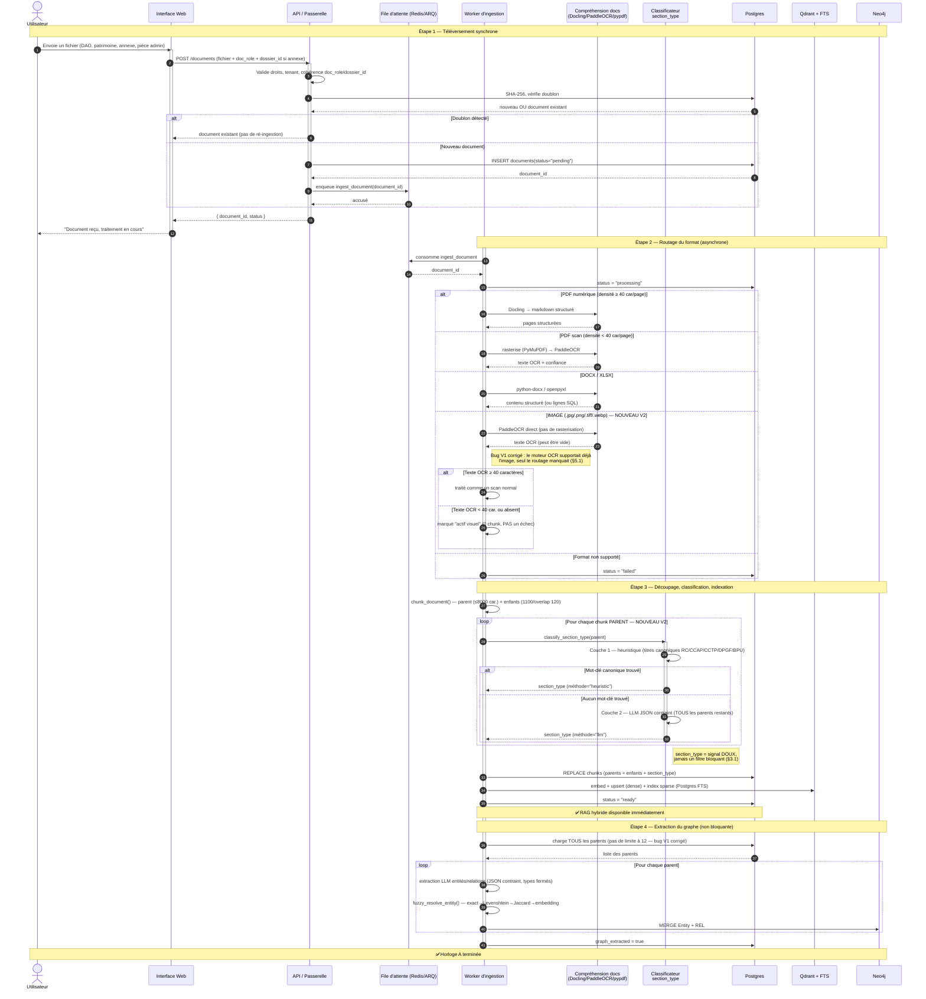
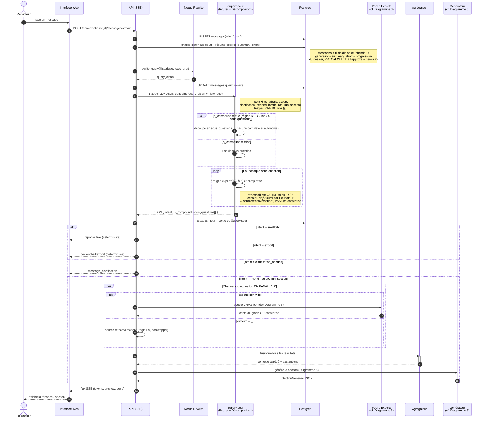
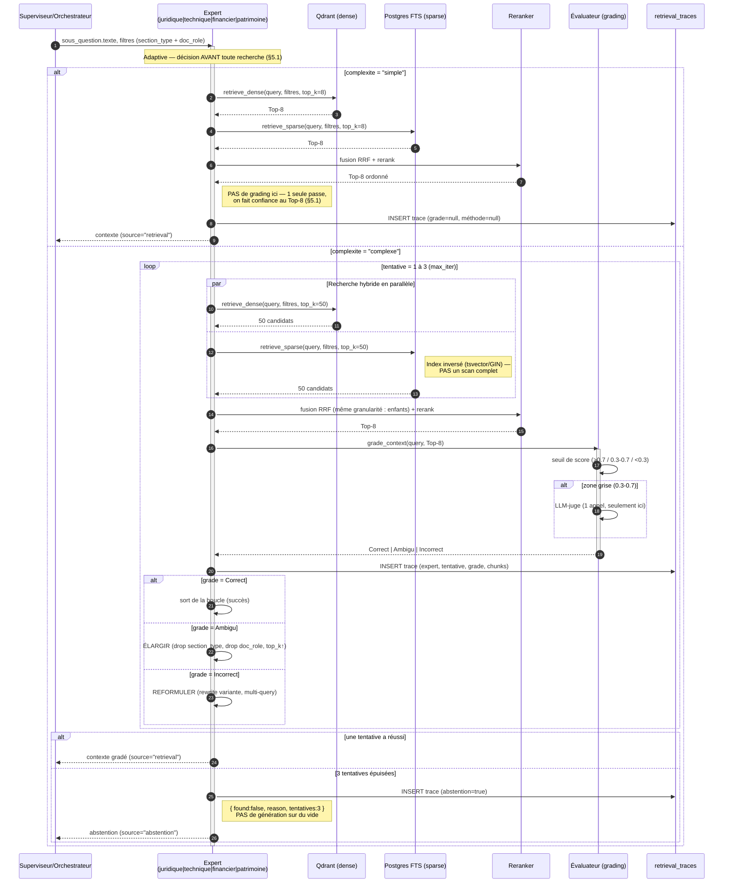
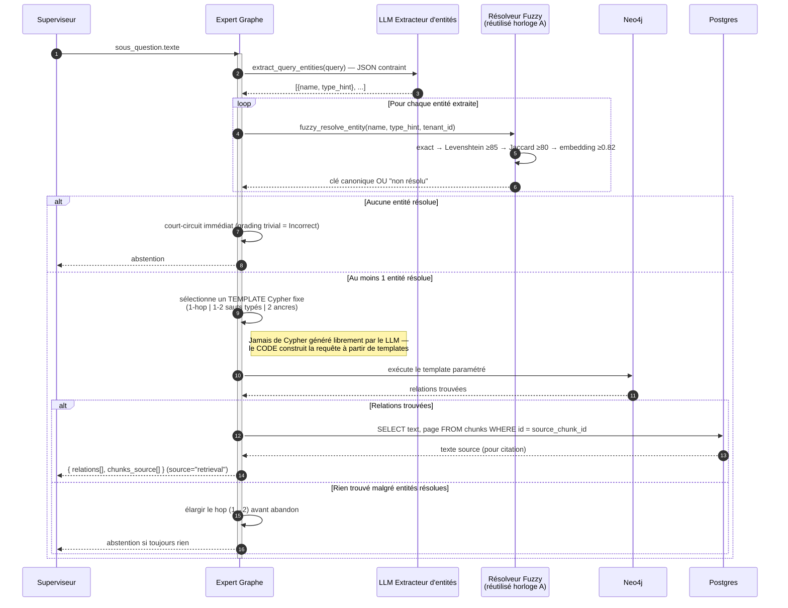
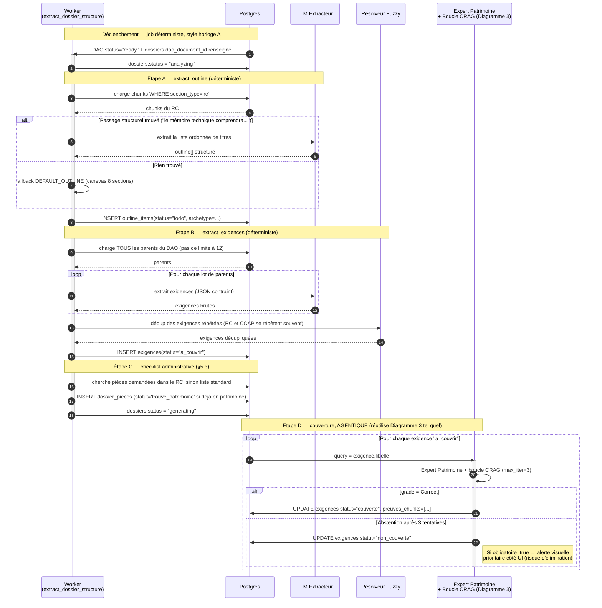
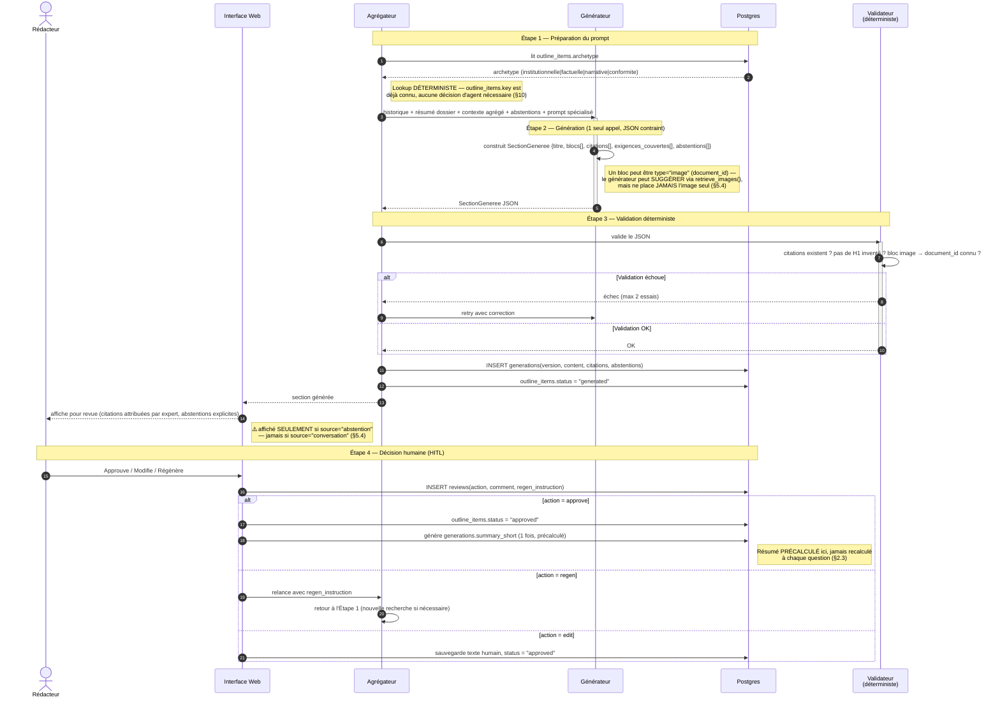

# Diagrammes de séquence V2 (Mermaid) — Horloge A, Horloge B, sous-processus

> **Format** : Mermaid `sequenceDiagram`, pas PlantUML — s'affiche directement dans la plupart des visionneuses Markdown (GitHub, VS Code avec l'extension Mermaid, etc.), sans outil externe. Équivalent complet de `diagrammes_sequence_v2.txt` (PlantUML), même contenu, syntaxe différente.
> **À lire avec** : `architecture_agentique_retrieval_generation.md` et `base_de_donnees_et_interface.md` — ces diagrammes illustrent ce qui y est décrit en détail, section par section.

---

## 0. Vue d'ensemble — croquis ASCII des deux horloges

```text
┌─────────────────────────────────────────────────────────────────────────┐
│                         NAVIGATEUR (React / Vite)                        │
└───────────────────────────────┬─────────────────────────────────────────┘
                                │ HTTP / SSE
                                ▼
┌─────────────────────────────────────────────────────────────────────────┐
│                    FastAPI  (backend_ao/app)                              │
└───────────────┬─────────────────────────────────────┬───────────────────┘
                │                                     │
     HORLOGE A (async, jobs)              HORLOGE B (sync / stream, agentique)
                │                                     │
                ▼                                     ▼
     Redis + worker ARQ                      Superviseur (LLM, §8)
     ingest_document                         │
     extract_graph                           ├─ intent = smalltalk/export → déterministe
     extract_dossier_structure               ├─ intent = clarification_needed → message
                │                            └─ intent = hybrid_rag | run_section
                ▼                                     │
     MinIO → parse → classify                         ▼
     → chunk (parent/enfant)              Dispatch sous-questions EN PARALLÈLE
     → Postgres + Qdrant                  → Experts (juridique/technique/
     → Neo4j (extraction graphe)             financier/graphe/patrimoine)
                │                          → Boucle CRAG bornée (max_iter=3)
                ▼                                     │
     outline_items / exigences /                      ▼
     dossier_pieces (extraction §9)        Agrégation (retrieval/abstention/
                                            conversation, §5.4)
                                                       │
                                                       ▼
                                            Génération par archétype (§10)
                                            → SectionGeneree JSON validé
                                                       │
                                                       ▼
                                            HITL (approve/edit/regen) → export
```

Table de correspondance rapide (quel diagramme répond à quelle question) :

| # | Diagramme | Répond à |
|---|---|---|
| 1 | Horloge A détaillée | Comment un fichier (PDF/DOCX/XLSX/**image**) devient des chunks cherchables + un graphe ? |
| 2 | Superviseur / routage | Comment une question est classée, décomposée, routée vers les experts ? |
| 3 | Boucle CRAG | Comment UN expert cherche, juge, corrige, ou abandonne (abstention) ? |
| 4 | Expert Graphe | Comment Neo4j est enfin lu en horloge B ? |
| 5 | Extraction exigences/outline/pièces | Comment `exigences`, `outline_items`, `dossier_pieces` sont remplis ? |
| 6 | Génération + HITL | Comment le texte final est écrit, validé, revu par un humain ? |

---

## 1. Horloge A — Ingestion détaillée (PDF / DOCX / XLSX / IMAGE)



---

## 2. Horloge B — Superviseur, décomposition, routage



---

## 3. Boucle CRAG bornée (pour UN expert)



---

## 4. Expert Graphe — résolution d'entités + Cypher



*Ce diagramme active la lecture de Neo4j en horloge B — écrit en horloge A (Diagramme 1, étape 4), jamais lu jusqu'ici.*

---

## 5. Alimentation exigences / outline_items / pièces administratives



---

## 6. Génération par archétype, validation, HITL



---

## Liens

- `Nouvelle_Architecture/architecture_agentique_retrieval_generation.md` — texte complet référencé par ces diagrammes (§ citées dans les notes)
- `Nouvelle_Architecture/base_de_donnees_et_interface.md` — schéma DB et interface associés
- `Nouvelle_Architecture/diagrammes_sequence_v2.txt` — même contenu en PlantUML (couleurs, légendes détaillées), pour l'export figure du mémoire LaTeX
